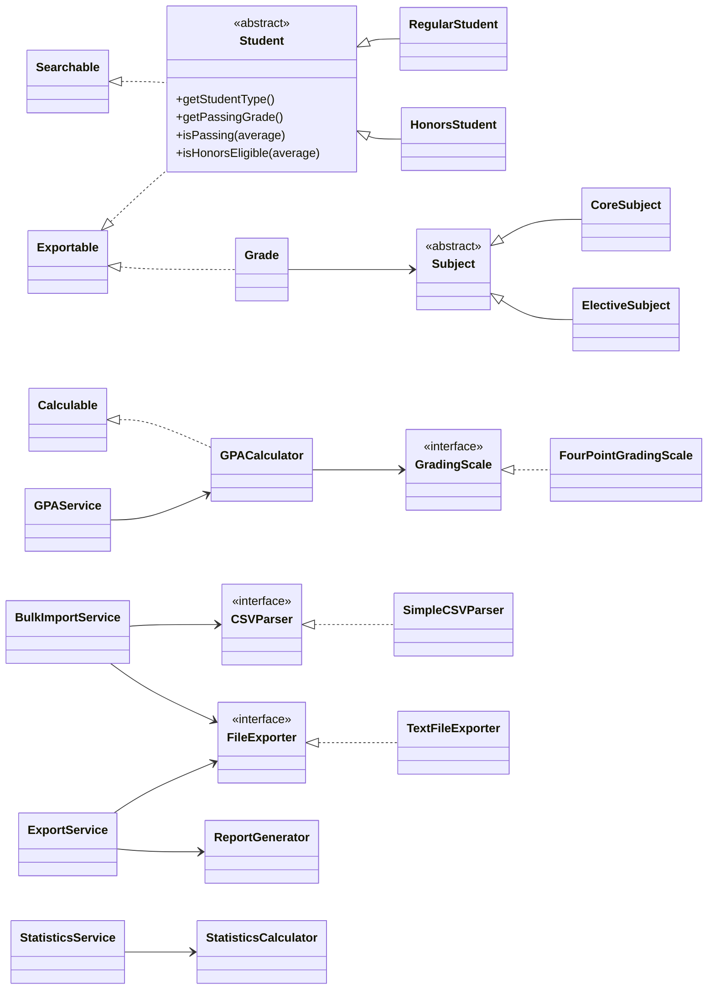
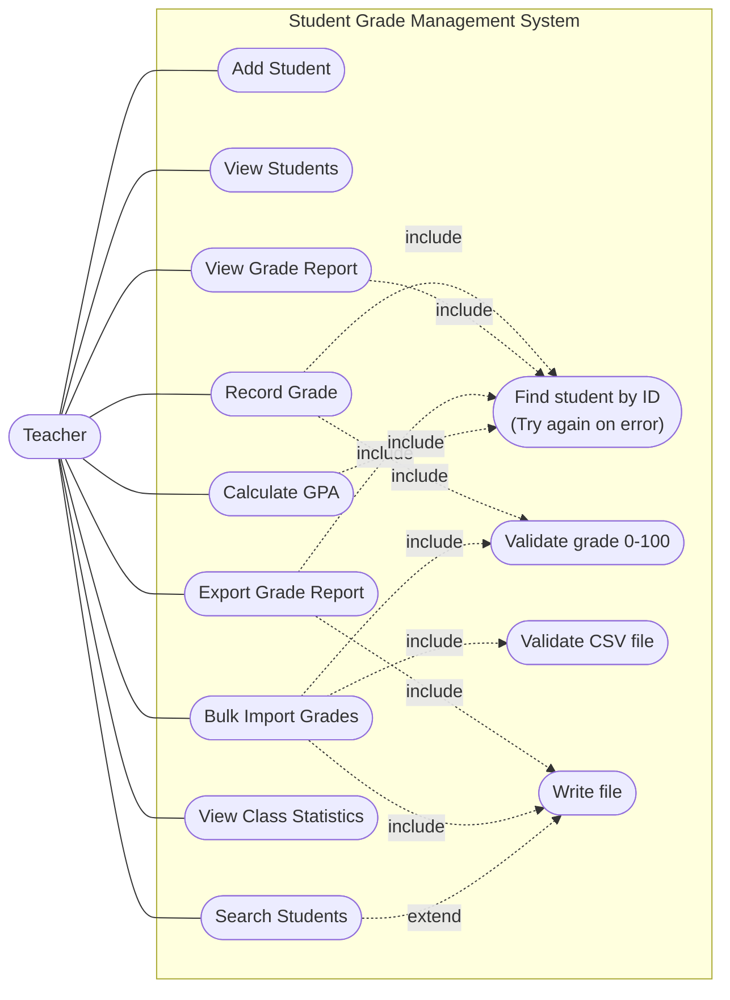

# Student Grade Management System

A Java console application that helps a teacher keep track of students and their grades.


## Features

| # | Menu option | What it does |
|---|---|---|
| 1 | Add Student | Registers a Regular or Honors student. Every field is validated as it is typed. IDs are generated automatically (STU001, STU002, ...). |
| 2 | View Students | Lists all students with average, passing status and honors eligibility, plus the class average. |
| 3 | Record Grade | Records a 0-100 grade for a Core or Elective subject. Wrong IDs and grades show a clear error and a "Try again?" prompt. |
| 4 | View Grade Report | Shows a student's full grade history, averages, GPA and passing status. |
| 5 | **Export Grade Report** | Saves a Summary, Detailed or combined report to `reports/<name>.txt` and shows the file size. |
| 6 | **Calculate Student GPA** | Converts every grade to the 4.0 scale, shows the cumulative GPA, letter grade, class rank and a performance analysis. |
| 7 | **Bulk Import Grades** | Reads a CSV file from `imports/`, imports the valid rows, skips bad rows with a reason, and writes a log to `logs/`. |
| 8 | **View Class Statistics** | Grade distribution chart, mean, median, mode, standard deviation, range, highest/lowest grade, subject averages and Regular vs Honors comparison. |
| 9 | **Search Students** | Search by ID (exact), name (partial, case-insensitive), average range or student type. Results can be viewed in detail or exported. |
| 10 | Exit | Closes the program. |

### Student types

| Type | Passing grade | Extra |
|---|---|---|
| Regular | 50% | Standard grading |
| Honors | 60% | Honors eligible while the average is 85% or higher |

### Subjects

| Type | Subjects |
|---|---|
| Core (mandatory) | Mathematics, English, Science |
| Elective (optional) | Music, Art, Physical Education |

---

## Requirements

- **Java 17 or newer** (check with `java -version`)
- **Maven 3.8 or newer** (check with `mvn -v`).

---


### First run

The program asks:

```
Load sample data (5 students, 25 grades)? (Y/N):
```

Answer **Y** to get students STU001 to STU005 with five grades each, so you can try
statistics, GPA ranking and search straight away. Then try option **7** with the file
name `sample_grades`: it has 15 rows, of which 13 import and 2 fail on purpose
(an unknown student and a grade of 105). The file `invalid_format` shows the
`InvalidFileFormatException`.

### CSV format for bulk import

Put the file in the `imports/` folder. The first line must be exactly this header:

```csv
StudentID,SubjectName,SubjectType,Grade
STU001,Mathematics,Core,85
STU002,English,Core,92
STU001,Music,Elective,78
```

When the program asks for the file name, type it **without** `.csv`.

### Where files are saved

| Folder | What is in it |
|---|---|
| `reports/` | Exported grade reports and search results (`.txt`) |
| `logs/app.log` | The application log, one timestamped line per event or error |
| `logs/import_log_<date>_<time>.txt` | A row-by-row log for every bulk import |

All three folders are created automatically and are ignored by Git.

---

## Running the tests

```bash
mvn test       # runs all 185 tests
mvn verify     # runs the tests AND fails the build if line coverage is below 80%
```

| Report | Where to find it |
|---|---|
| Test results | `target/surefire-reports/` (one `.txt` and `.xml` file per test class) |
| Coverage report | `target/site/jacoco/index.html` (open it in a browser) |

In IntelliJ: right-click the `src/test/java` folder → **Run 'All Tests'**, or
**Run 'All Tests' with Coverage**.

Current results:

| Area | Target | Achieved (line coverage) |
|---|---|---|
| Overall | 80%+ | **99%** |
| GPA and statistics calculators | 95%+ | **100%** |
| Exception classes | 100% | **100%** |
| Service classes | 85%+ | **100%** |

The suite has **185 tests**: unit tests for every class, integration tests that use
**Mockito** mocks (`BulkImportServiceTest`, `ExportServiceTest`, `GPAServiceTest`,
`SearchServiceTest`, `StatisticsServiceTest`, `GPACalculatorTest`), and end-to-end tests
(`ApplicationFlowTest`) that start the real application and "type" into the menu.

---

## Project structure

```
Student-Grade-Management-System/
├── pom.xml                       Maven build file (dependencies, coverage rule)
├── imports/                      Sample CSV files for bulk import
├── docs/                         Testing guide, Git workflow, pull request notes
├── .github/workflows/ci.yml      Runs "mvn verify" on GitHub for every push
└── src/
    ├── main/java/com/gradesystem/
    │   ├── Main.java             Creates every object and starts the menu
    │   ├── model/                Student, Subject, Grade and the Searchable/Exportable interfaces
    │   ├── exception/            The 9 custom exceptions
    │   ├── calculator/           GPA and statistics math (no input/output)
    │   ├── io/                   CSV reading and file writing
    │   ├── service/              Business logic: managers, search, GPA, statistics, export, import
    │   ├── ui/                   Console input/output helpers and the main menu
    │   │   └── screens/          One class per menu option
    │   └── util/                 Constants, validation, logging, formatting
    └── test/java/com/gradesystem/   Tests, in the same packages as the code they test
```

---

## How the code is organised (SOLID)



| Principle | Where you can see it |
|---|---|
| **S**ingle Responsibility | `ReportGenerator` only builds report text. `TextFileExporter` only writes files. `GPACalculator` only does GPA math. `StatisticsCalculator` only does statistics. `SimpleCSVParser` only reads CSV. Each menu option is its own small `Screen` class. `Student` no longer reaches into the `GradeManager` (it did in Lab 1). |
| **O**pen/Closed | New student or subject types are new subclasses; menus read the subject types from `SubjectCatalog`, so they update automatically. A new grading scale is a new `GradingScale` class (strategy pattern). A new menu option is a new `Screen` class added to the list in `Main`; `ConsoleMenu` never changes. |
| **L**iskov Substitution | Any `Student` works wherever a `Student` is expected. The Lab 1 `instanceof HonorsStudent` check was replaced by `isHonorsEligible()`, which every student has (Regular returns `false`). |
| **I**nterface Segregation | Small, focused interfaces: `Searchable` (1 method), `Exportable` (1 method), `Calculable` (1 method), `CSVParser`, `FileExporter`, `GradingScale`, `Screen`, `InputCheck`. |
| **D**ependency Inversion | `BulkImportService` depends on the `CSVParser` and `FileExporter` **interfaces**, not on concrete classes. Every service gets what it needs through its constructor (dependency injection). `Main.createMenu()` is the only place that uses `new` to connect things, which is why tests can swap in mocks. |

---

## Exception handling

All custom exceptions extend `GradeSystemException`, which adds a **recovery hint**
(a tip telling the user how to fix the problem). They are *checked* exceptions, so
the compiler forces every one of them to be handled. The code never catches the
generic `Exception`: every `catch` names the exact exception it expects.

| Exception | Thrown when | Example hint shown to the user |
|---|---|---|
| `StudentNotFoundException` | No student has the ID | `Available student IDs: STU001, STU002, ...` |
| `InvalidGradeException` | Grade is not a number or not 0-100 | `You entered: 150` |
| `InvalidFileFormatException` | CSV is empty, has no rows or a wrong header | `The first line must be: StudentID,SubjectName,SubjectType,Grade` |
| `SubjectNotFoundException` | CSV row names a subject/type that does not exist | `Available subjects: Mathematics (Core), ...` |
| `InvalidInputException` | Bad name, email, phone, age, file name or search range | `Example: name@school.edu` |
| `NoGradesException` | GPA or report requested for a student without grades | `Record a grade first (option 3) ...` |
| `FileImportException` | CSV file is missing or cannot be read | `Place the CSV file in the ./imports/ folder ...` |
| `FileExportException` | A report or log cannot be written | `Check that the folder exists and you have permission ...` |
| `InputClosedException` | The console input ends (Ctrl+D) | The menu closes politely instead of crashing |

Every error the user sees is printed by `ConsoleIO.showError()`, which also writes it to
the log with a timestamp, in the format from the brief:

```
✗ ERROR: InvalidGradeException
  Grade must be between 0 and 100.

  You entered: 150

  Try again? (Y/N):
```

Most errors are prevented before they happen: names, emails, phones and file names are
validated as they are typed, and menu choices only accept numbers in range.

---

## Logging

`AppLogger` sets up Java's built-in `java.util.logging` once for the whole app. Log
lines go to `logs/app.log` (never to the console, so menus stay clean):

```
[2026-10-18 14:05:11] INFO    StudentManager - Added student STU006 (Hana Mori)
[2026-10-18 14:05:40] WARNING ConsoleIO - InvalidGradeException: Grade must be between 0 and 100.
[2026-10-18 14:06:02] WARNING BulkImportService - Import sample_grades Row 7: Invalid student ID (STU999)
[2026-10-18 14:06:15] INFO    TextFileExporter - Wrote file /home/me/project/reports/alice.txt
```

---

## GPA scale

| Percentage | GPA | Letter |
|---|---|---|
| 93-100% | 4.0 | A |
| 90-92% | 3.7 | A- |
| 87-89% | 3.3 | B+ |
| 83-86% | 3.0 | B |
| 80-82% | 2.7 | B- |
| 77-79% | 2.3 | C+ |
| 73-76% | 2.0 | C |
| 70-72% | 1.7 | C- |
| 67-69% | 1.3 | D+ |
| 60-66% | 1.0 | D |
| Below 60% | 0.0 | F |

Cumulative GPA is the average of the GPA points of all grades. The letter for a
cumulative GPA is the highest row it reaches (3.74 → 3.7 → A-).

> **Note:** Screenshot 3 in the project brief shows 92% as 4.0 (A), which contradicts the
> brief's own table above (90-92% = 3.7, A-). This program follows the **table**, so Bob's
> numbers differ from the screenshot. The table is tested row by row in
> `FourPointGradingScaleTest`.

The class statistics distribution uses simple 10-point bands (A = 90-100, B = 80-89, ...),
exactly as in Screenshot 5.

---

## Use case diagram



---

## More documentation

| File | What is in it |
|---|---|
| [CHANGELOG.md](CHANGELOG.md) | Every feature and change, version by version |
| [docs/TESTING_GUIDE.md](docs/TESTING_GUIDE.md) | How to run the tests, read the reports, and do the 8 manual test scenarios |
| [docs/GIT_WORKFLOW.md](docs/GIT_WORKFLOW.md) | Branching strategy, commit message rules and the pull request process |
| [docs/pull-requests/](docs/pull-requests/) | A description of every pull request |

### Static analysis

- The compiler runs with `-Xlint:all` and the code compiles with **zero warnings**.
- `mvn javadoc:javadoc` builds the JavaDoc with **zero warnings** (every public class and method is documented).
- In IntelliJ, **Code → Inspect Code...** runs IntelliJ's own static analysis on the whole project.
