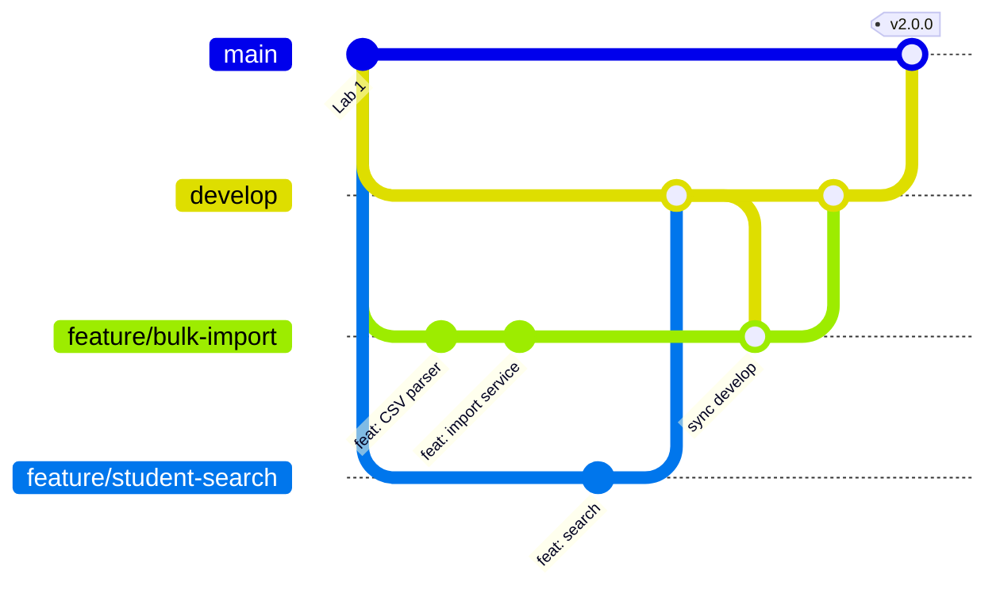

# Git Workflow

This project uses a **feature branch workflow** (a simplified Git Flow).

---

## 1. Branches

| Branch | Purpose | Rules |
|---|---|---|
| `main` | Production-ready code. Only releases are merged here. | Protected: no direct commits. Changes arrive only from `develop` (or `hotfix/*`). |
| `develop` | Integration branch. Finished features are merged here. | No direct commits; merge via pull request. |
| `feature/*` | One branch per feature, e.g. `feature/bulk-import`. | Created from `develop`, merged back into `develop`. |
| `bugfix/*` | Fixes for bugs found on `develop`, e.g. `bugfix/search-export-newline`. | Created from `develop`, merged back into `develop`. |
| `hotfix/*` | Emergency fixes for `main`. | Created from `main`, merged into `main` **and** `develop`. |



### Protecting `main` on GitHub
**Settings → Branches → Add branch protection rule** → Branch name pattern `main` →
tick **Require a pull request before merging** and **Require status checks to pass**
(choose the `build` check from the CI workflow). Do the same for `develop`.

---

## 2. Commit messages (Conventional Commits)

Format: `type: short description in the present tense`

| Type | Use it for | Example |
|---|---|---|
| `feat` | A new feature | `feat: add GPA calculation feature` |
| `fix` | A bug fix | `fix: correct median calculation for even count` |
| `test` | Adding or changing tests | `test: add unit tests for statistics calculator` |
| `refactor` | Changing code without changing behaviour | `refactor: decouple Student from GradeManager` |
| `docs` | Documentation only | `docs: add testing guide` |
| `build` | Build system or dependencies | `build: add Maven pom with JUnit and Mockito` |
| `ci` | CI configuration | `ci: run mvn verify on GitHub Actions` |
| `chore` | Anything else (gitignore, sample files) | `chore: add sample CSV files` |

Good habits:
- One logical change per commit (code + its tests can go together).
- Write what the commit **does**, not what you did: "add search service", not "added stuff".
- Keep the first line under about 70 characters.

---

## 3. The workflow, step by step

The example builds `feature/bulk-import`.

```bash
# 1. Start from an up-to-date develop
git checkout develop
git pull origin develop

# 2. Create the feature branch
git checkout -b feature/bulk-import

# 3. Work and commit regularly
git add src/main/java/com/gradesystem/io/
git commit -m "feat: add CSV parser with header validation"

# 4. Write tests for the feature
git add src/test/java/com/gradesystem/io/
git commit -m "test: add CSV parser tests"

# 5. Bring in what others merged to develop meanwhile, and fix conflicts
git fetch origin
git merge origin/develop
#   if there are conflicts: open the files, fix the <<<<<<< ======= >>>>>>> parts,
#   then: git add <file>  and  git commit
mvn verify            # make sure everything still passes after the merge

# 6. Push and open a pull request into develop on GitHub
git push -u origin feature/bulk-import
#   GitHub → "Compare & pull request" → base: develop ← compare: feature/bulk-import
#   Fill in the template (.github/pull_request_template.md), wait for CI to pass

# 7. After review, merge the pull request ("Create a merge commit"), then clean up
git checkout develop
git pull origin develop
git branch -d feature/bulk-import

# 8. When develop is ready for release, open a pull request develop → main,
#    merge it, and tag the release
git checkout main
git pull origin main
git tag -a v2.0.0 -m "Release 2.0.0"
git push origin v2.0.0
```

---

## 4. Branches used in this project

| # | Branch | Pull request description |
|---|---|---|
| 1 | `feature/project-setup` | [PR-01](pull-requests/PR-01-project-setup.md) |
| 2 | `feature/exception-handling` | [PR-02](pull-requests/PR-02-exception-handling.md) |
| 3 | `feature/solid-refactor` | [PR-03](pull-requests/PR-03-solid-refactor.md) |
| 4 | `feature/gpa-calculation` | [PR-04](pull-requests/PR-04-gpa-calculation.md) |
| 5 | `feature/class-statistics` | [PR-05](pull-requests/PR-05-class-statistics.md) |
| 6 | `feature/export-reports` | [PR-06](pull-requests/PR-06-export-reports.md) |
| 7 | `feature/student-search` | [PR-07](pull-requests/PR-07-student-search.md) |
| 8 | `feature/bulk-import` (merged `develop` in before its PR) | [PR-08](pull-requests/PR-08-bulk-import.md) |
| 9 | `feature/console-ui` | [PR-09](pull-requests/PR-09-console-ui.md) |
| 10 | `bugfix/search-export-newline` | [PR-10](pull-requests/PR-10-bugfixes.md) |
| 11 | `bugfix/statistics-alignment` | [PR-10](pull-requests/PR-10-bugfixes.md) |
| 12 | `feature/documentation` | [PR-11](pull-requests/PR-11-documentation.md) |
| 13 | `develop` → `main` (release v2.0.0) | [PR-12](pull-requests/PR-12-release-2.0.0.md) |

Useful commands to review the history:

```bash
git log --oneline --graph --all
git log --oneline | wc -l
git branch -a
git show v2.0.0
```
